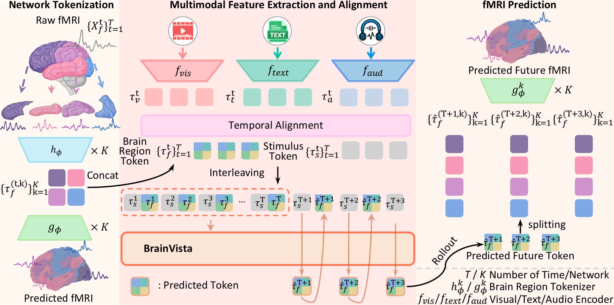
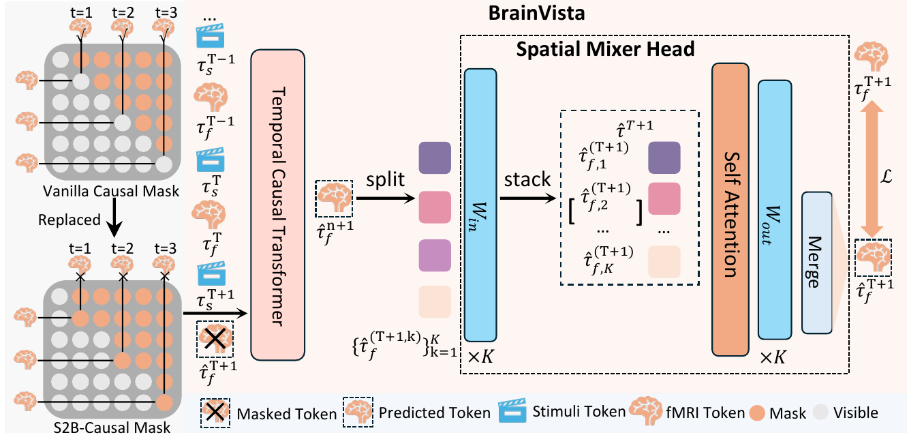

<div align="center">

# BrainVista: Modeling Naturalistic Brain Dynamics as Multimodal Next-Token Prediction

**NeurIPS 2026**

Xuanhua Yin<sup>1</sup> · Runkai Zhao<sup>1</sup> · Lina Yao<sup>2,3</sup> · Weidong Cai<sup>1</sup>

<sup>1</sup>The University of Sydney &nbsp; <sup>2</sup>University of New South Wales &nbsp; <sup>3</sup>CSIRO's Data61
<br>📧 [xuanhua.yin@sydney.edu.au](mailto:xuanhua.yin@sydney.edu.au)

[](https://neurips.cc/Conferences/2026)
[](https://arxiv.org/abs/2602.04512)
[](https://xuanhuayin.github.io/BrainVista/)
[](https://arxiv.org/pdf/2602.04512)


[**Paper**](https://arxiv.org/abs/2602.04512) · [**Project Page**](https://xuanhuayin.github.io/BrainVista/) · [**Installation**](#installation) · [**Data**](#data-preparation) · [**Training & Evaluation**](#training-and-evaluation) · [**Citation**](#citation)

</div>

BrainVista forecasts naturalistic fMRI as **observed-stimulus conditional autoregressive prediction**.
It predicts future brain states from past brain activity and from stimulus tokens aligned to each
queried fMRI bin. During rollout it feeds back its own predictions and never sees target or future
ground-truth fMRI.



Three components:

* **Network-wise Tokenizers**: one independent MLP tokenizer–detokenizer pair per functional
  network (Yeo-7, or dataset-defined ROI groups). They are pretrained with reconstruction only and
  then frozen.
* **Stimulus-to-Brain (S2B) mask**: stimulus and brain tokens are interleaved. Stimulus tokens
  form a stimulus-only causal stream; brain tokens read causally available stimuli and past brain
  tokens. The final brain slot is a learnable target query, not an encoding of the target fMRI.
* **Spatial Mixer Head**: self-attention over the K network components of the predicted latent,
  with network-specific input/output projections. It is applied before frozen detokenization.

<p align="center"></p>

## Main results

Conditional autoregressive forecasting with horizon H = 20 (pattern correlation p<sub>corr</sub>; full tables with r and
Cls@Top10 in the paper and on the [project page](https://xuanhuayin.github.io/BrainVista/)).

| Model | Algonauts 2025 | CineBrain | HAD |
|---|:---:|:---:|:---:|
| Transformer-ARX | 0.1819 | 0.4978 | 0.2724 |
| BrainHarmony-AR | 0.1887 | 0.5156 | 0.2769 |
| **BrainVista** | **0.2090** | **0.5643** | **0.2950** |

## Contents

```
brainvista/                    library
  models/predictor.py          BrainVista: interleaved Transformer, S2B / causal / bidirectional masks,
                               Spatial Mixer Head (attention / linear / none), input-source modes
  models/tokenizer.py          network-wise MLP tokenizer (EncAE) and detokenizer (Dec)
  data/                        run lists, on-disk lookup, temporal alignment, training-set normalization,
                               windowed datasets, stimulus constructions and negative controls
  rollout.py                   batched conditional autoregressive rollout
  metrics.py                   r, p_corr, Cls@TopK, MSE, Spearman, 2v2, r_traj, drift, PSD distance
  evaluation.py, checkpoint.py shared evaluation loop and checkpoint loading
train_tokenizer.py             stage 1: tokenizer pretraining (Eq. 14)
export_z.py                    export brain region tokens with a frozen tokenizer
train_predictor.py             stage 2: next-token prediction with teacher forcing (Eq. 15)
evaluate.py                    held-out rollout evaluation (all valid anchors, H = 1/10/20)
inference.py                   save rollout trajectories and Spatial Mixer attention
preprocessing/                 Schaefer -> Yeo-7 split, surface -> parcels (HAD), training-split PCA,
                               transcript conversion, feature-extraction manifests
feature_extraction/            frozen V-JEPA 2 / Wav2Vec2-BERT / Llama 3.2 features on an end-aligned TR grid
analysis/                      history occlusion, mixer attention, emotion clustering,
                               paired subject statistics, summary merging
scripts/                       end-to-end shell pipeline + dataset configs (Algonauts 2025, CineBrain, HAD)
tests/                         unit tests for the input-access rules and a synthetic end-to-end smoke test
```

## Installation

```bash
git clone https://github.com/xuanhuayin/BrainVista && cd BrainVista
pip install -r requirements.txt        # PyTorch >= 2.1; feature extraction also needs ffmpeg
```

All experiments in the paper ran on a single GPU with PyTorch automatic mixed precision.

## Data preparation

We do not redistribute any data or pretrained weights. Obtain them from the official sources:
[Algonauts 2025](https://algonautsproject.com/) ([CNeuroMod](https://www.cneuromod.ca/)),
[CineBrain](https://jianxgao.github.io/CineBrain), [HAD](https://openneuro.org/datasets/ds004488) (OpenNeuro ds004488),
[V-JEPA 2](https://huggingface.co/facebook/vjepa2-vitg-fpc64-256),
[w2v-BERT 2.0](https://huggingface.co/facebook/w2v-bert-2.0),
[Llama 3.2 3B](https://huggingface.co/meta-llama/Llama-3.2-3B) (gated), and
[Schaefer 2018 atlases](https://github.com/ThomasYeoLab/CBIG/tree/master/stable_projects/brain_parcellation/Schaefer2018_LocalGlobal).

### Layout

```
FMRI_ROOT/<network>/<subj>/<rid>.npy     (T, P_k)        model-space fMRI of network k (not normalized)
VIDEO_ROOT/<feature id>.npy              (T*ratio, [n_layers,] D_v)   or VIDEO_ROOT/<subj>/<rid>.npy
AUDIO_ROOT/..., TEXT_ROOT/...            same convention
splits/{train,val,test}.txt              one "subj rid" per line (official run-level splits)
```

Brain region tokens (`Z_ROOT/z_<network>/<subj>/<rid>_z.npy`) and checkpoints are produced by the
pipeline. Normalization statistics are always estimated on training runs only and stored inside
the tokenizer checkpoints. Validation runs are used only for model selection. Test runs are scored
once.

### fMRI

| Dataset | TR | Model space | Command |
|---|---|---|---|
| Algonauts 2025 | 1.49 s | Schaefer-1000 → Yeo-7 | `python preprocessing/split_schaefer_networks.py --h5_dir <release fmri dir> --out_root FMRI_ROOT` |
| HAD | 2.0 s | fsLR surface → Schaefer-1000 → Yeo-7 | `python preprocessing/surface_to_schaefer.py --manifest runs.csv --dlabel Schaefer2018_1000Parcels_7Networks_order.dlabel.nii --out_dir PARCELS`, then `split_schaefer_networks.py --npy_dir PARCELS --labels_file PARCELS/parcel_labels.txt --out_root FMRI_ROOT` |
| CineBrain | 0.8 s | visual / auditory ROI voxels → training-split PCA (512 each) | `python preprocessing/train_pca.py --in_root ROI_VOXELS --groups Visual Auditory --n_components 512 --train_list_file train.txt --run_list_file train.txt val.txt test.txt --subjects sub-01 ... --out_root FMRI_ROOT` |

`split_schaefer_networks.py` writes `networks.json` with the parcel count P_k of every network. The
token size is d_k = ceil(0.8 · P_k) unless `--z_dim` is given.

### Stimulus features

Features are extracted on a **TR-locked, end-aligned grid**: bin t (scan time [t·TR, (t+1)·TR)) receives
`ratio` samples whose extraction windows end at t·TR + (j+1)·TR/ratio. Every window therefore ends no
later than the bin boundary, and the training code mean-pools the `ratio` samples of each bin
(paper Eq. 3).

```bash
# Manifests: rid,path[,n_bins,onset_offset]. Use the same feature id for every subject that saw the clip.
python preprocessing/make_manifest.py --glob "stimuli/movies/friends/**/*.mkv" \
    --rid_regex "s\d{2}e\d{2}[a-d]" --rid_format "task-{}" --out video_manifest.csv

python feature_extraction/extract_video_vjepa2.py  --manifest video_manifest.csv --tr 1.49 --ratio 3 --window 2.0 --out_root raw/video
python feature_extraction/extract_audio_w2vbert.py --manifest video_manifest.csv --tr 1.49 --ratio 3 --window 1.0 --out_root raw/audio

# Text: word events (onset, offset, text); a word becomes visible when it ends.
python preprocessing/algonauts_transcripts_to_events.py --transcript_dir stimuli/transcripts --out_dir text_events
python feature_extraction/extract_text_llama.py --manifest text_manifest.csv --tr 1.49 --ratio 3 --out_root raw/text
#   HAD clip descriptions: --visibility annotations (visible only during their clip)

# Modality-specific compression, fitted on training stimuli only (V 512, A 256, T 512)
python preprocessing/train_pca.py --in_root raw --groups video --n_components 512 --shared \
    --train_list_file train.txt --run_list_file train.txt val.txt test.txt --out_root features
```

For Algonauts, use `--feature_id_regex 'task-[A-Za-z0-9]+'` during training. It maps run ids such as
`ses-003_task-s01e02a` to the shared feature id `task-s01e02a`. HAD has no audio stream
(`--modalities video text`, `--ratio_a 0`). A missing modality is dropped from the concatenation
instead of being zero-padded.

## Training and evaluation

Edit a config in `scripts/configs/` and run the stages in order:

```bash
bash scripts/train_tokenizer.sh scripts/configs/algonauts2025.sh   # tokenizers + token export, per subject
bash scripts/train_predictor.sh scripts/configs/algonauts2025.sh   # predictor + test evaluation, per subject
bash scripts/inference.sh       scripts/configs/algonauts2025.sh   # rollout trajectories + mixer attention
bash scripts/analysis.sh        scripts/configs/algonauts2025.sh   # history occlusion + mixer attention summaries
```

Default hyperparameters (paper Appendix A.9):

| | |
|---|---|
| Predictor | Pre-LN Transformer, d_model 256, 8 heads, 4 layers, GELU, FFN 4×, dropout 0.1, absolute positions |
| Context / horizon | L = 40, H = 20 (evaluated at H ∈ {1, 10, 20}) |
| Spatial Mixer | one self-attention layer over K network tokens, d_z = 128, 4 heads |
| Optimization | AdamW, lr 2e-4, weight decay 1e-2 (not on LayerNorm / biases), batch 32, 40 epochs, grad clip 0.5, AMP |
| Tokenizers | two-layer MLP per network, reconstruction loss only, frozen before stage 2 |

Every training run writes `tokenizer_cfg.json` / `predictor_cfg.json` (resolved settings, data
dimensions, git commit) next to its checkpoints. Evaluation and inference inherit the data
settings (networks, modalities, ratios, stimulus offset) from the predictor checkpoint.

### Evaluation protocol

`evaluate.py` starts an H-step rollout from **every valid anchor** of every test run. With m = L,
one-step anchors are m ≤ u ≤ T_r − 1 (N = T_r − m per run), and H-step anchors are m ≤ u ≤ T_r − H
(N = T_r − m − H + 1). Windows never cross runs. Predictions are detokenized into the normalized
model space and compared with the normalized fMRI. Metrics are computed per subject and averaged
over subjects:

* `r`: Pearson correlation of the vectorized trajectories, pooled over a subject's segments
  (`r_segment` gives the per-segment mean);
* `p_corr`: correlation across parcels at each time step, averaged over steps
  (`p_corr_per_step` gives the curve over h);
* `cls_top10`: rank of the matched ground-truth segment among a same-subject candidate pool of
  size N (`--cls_pool_size`: 200 / 400 / 300 for Algonauts / CineBrain / HAD), with distractors
  from other runs that do not overlap the query;
* `mse`, `rho`, `2v2`, `r_traj`, `drift_mu`, `drift_sigma`, `psd_dist`, and per-network `p_corr`
  and `r`.

`analysis/merge_eval_summaries.py` merges the per-subject summaries. `analysis/subject_stats.py`
reports paired differences, bootstrap CIs, win counts and one-sided sign / Wilcoxon tests between
two models.

### Ablations and controls

| Paper experiment | Option |
|---|---|
| Temporal mask: bidirectional / vanilla causal / S2B | `--mask bidirectional \| causal \| s2b` |
| Spatial Mixer: none / linear / attention | `--mixer none \| linear \| attn` |
| Input source: stimulus only / past fMRI only | `--input_mode stim_only \| brain_only` |
| Stimulus cutoff s^{<u}, lag sweep (in TR steps) | `--stim_offset 1`, `--stim_offset k` (negative = diagnostic look-ahead) |
| HRF-convolved / causal FIR stimulus features | `--stim_transform hrf --tr TR`, `--stim_transform fir --fir_lags 4` |
| Modality ablation | `--modalities video text`, etc. |
| Shifted-stimulus negative controls | `evaluate.py --stim_control circular \| cross_run --tr TR` |
| Training-data scaling | `--train_fraction 0.25` (complete units) |
| Normalization diagnostic | `train_tokenizer.py --norm_mode run` |
| Cross-subject / leave-one-subject-out | `scripts/cross_subject.sh`, `--norm_train_list_file` |

`scripts/ablations.sh` runs these variants. The baselines (Ridge-, LSTM-, TemporalCNN-,
Transformer-ARX, BrainHarmony-AR and the non-ARX references) are described in the paper
appendix and are not part of this repository.

### Analyses

* `analysis/history_occlusion.py`: increase in one-step L2 error per network when the brain token
  at lag l is hidden from attention.
* `analysis/mixer_attention.py`: K × K Spatial Mixer attention averaged over anchors, steps and heads.
* `analysis/emotion_clustering.py`: PCA + K-means on clip-averaged forecasts (run `inference.py --anchors tile` first).

History occlusion and attention describe the fitted model. They are not evidence of biological
causality or connectivity.

## Tests

```bash
python -m pytest tests -q            # input-access rules: S2B, anchors, stimulus cutoff, rollout uses no future fMRI
bash tests/smoke_test.sh             # synthetic data through tokenizers, export, training, evaluation, inference
```

## Notes

* `train_tokenizer.py` and `export_z.py` keep the checkpoint format of the original release.
  Predictor checkpoints from that release still load: they are recognized by the missing `mask`
  entry and use the strictly-past brain→brain rule (t_j < t_i) they were trained with. New models
  use the paper's rule t_j ≤ t_i, `--brain_self_attn 1`.
* The paper does not specify how stimulus features are compressed to 512 / 256 / 512 dimensions.
  This repository uses training-split PCA (`preprocessing/train_pca.py`).

## Citation

```bibtex
@inproceedings{yin2026brainvista,
  title     = {BrainVista: Modeling Naturalistic Brain Dynamics as Multimodal Next-Token Prediction},
  author    = {Yin, Xuanhua and Zhao, Runkai and Yao, Lina and Cai, Weidong},
  booktitle = {Advances in Neural Information Processing Systems (NeurIPS)},
  year      = {2026}
}
```
